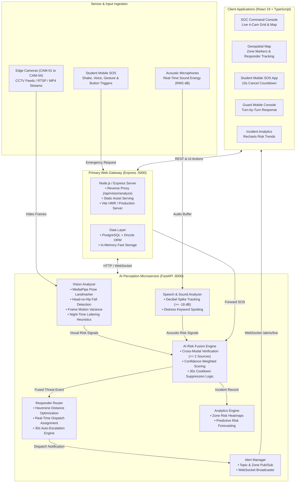

# SafeNet AI 🛡️
### Autonomous Campus Safety & Real-Time Emergency Response Platform

[](https://react.dev/)
[](https://www.typescriptlang.org/)
[](https://fastapi.tiangolo.com/)
[](https://www.python.org/)
[](https://opencv.org/)
[](https://developers.google.com/mediapipe)
[](https://nodejs.org/)
[](https://tailwindcss.com/)
[](LICENSE)

> **SafeNet AI** is a real-time, privacy-first campus security and emergency response platform. Engineered to replace passive CCTV surveillance with autonomous threat perception, SafeNet AI fuses edge computer vision, real-time acoustic distress detection, and mobile SOS signals into a unified risk scoring engine with automated responder dispatch and geospatial live tracking.

---

## 📑 Table of Contents

- [Overview](#-overview)
- [System Architecture](#-system-architecture)
- [Key Features](#-key-features)
  - [Security Operations Center (SOC) Console](#1-security-operations-center-soc-console)
  - [Real-Time Computer Vision Intelligence](#2-real-time-computer-vision-intelligence)
  - [Acoustic Emergency Perception](#3-acoustic-emergency-perception)
  - [Multi-Modal AI Risk Fusion Engine](#4-multi-modal-ai-risk-fusion-engine)
  - [Autonomous Dispatch & Escalation Routing](#5-autonomous-dispatch--escalation-routing)
  - [Student Silent SOS Mobile Application](#6-student-silent-sos-mobile-application)
  - [Security Guard Mobile Console](#7-security-guard-mobile-console)
  - [Incident Intelligence & Predictive Analytics](#8-incident-intelligence--predictive-analytics)
- [Privacy by Design & Ethical AI](#-privacy-by-design--ethical-ai)
- [Tech Stack](#-tech-stack)
- [Repository Structure](#-repository-structure)
- [API & WebSocket Reference](#-api--websocket-reference)
- [Installation & Local Setup](#-installation--local-setup)
- [Live Simulation & Testing](#-live-simulation--testing)
- [Configuration & Environment Variables](#-configuration--environment-variables)
- [Contributing](#-contributing)
- [Author & License](#-author--license)

---

## 🌟 Overview

Conventional campus safety systems are reactive: security personnel must monitor dozens of camera feeds simultaneously, or wait for victims or bystanders to dial emergency dispatch. In critical moments—such as medical collapses, nighttime assaults, or crowd stampedes—seconds determine outcomes.

**SafeNet AI transforms physical security into an autonomous perception network**:
1. **Perceives Anomalies Continuously**: AI monitors video streams and acoustic spikes locally without recording biometric identifiers.
2. **Fuses Multi-Modal Signals**: Correlates visual posture anomalies with audio decibel spikes and mobile sensor triggers to filter out false alarms.
3. **Dispatches in Real Time**: Calculates proximity using geospatial algorithms (Haversine formula), routes the nearest guard, and escalates automatically if unacknowledged within 30 seconds.
4. **Protects Student Privacy**: Employs a zero-storage architecture where raw video and audio are processed ephemerally in RAM and never saved to disk.

---

## 🏗️ System Architecture

SafeNet AI is structured as a dual-engine platform: a high-performance **React 19 + Express.js gateway** serving the client applications and dashboard, paired with a specialized **Python FastAPI AI microservice** running MediaPipe Tasks, OpenCV, and acoustic analysis.



---

## 🚀 Key Features

### 1. Security Operations Center (SOC) Console
- **Multi-Camera Live Matrix**: Monitors 4 simultaneous campus streams (`CAM-01 Library Entrance`, `CAM-02 Main Quad`, `CAM-03 Dorm Lobby`, `CAM-04 Parking Lot B`) with scanline visual effects and detection overlays.
- **Dynamic Threat Highlighting**: Feeds experiencing active emergencies pulse with high-contrast alert borders and bounding boxes.
- **One-Click Simulation**: Instant emergency drill switch to validate staff readiness, automated broadcasts, and guard dispatches.
- **Geospatial Campus Map**: Integrated dark-mode map pinpointing coordinates, active zones, and real-time distress locations.

### 2. Real-Time Computer Vision Intelligence
- **MediaPipe Tasks Pose Landmarker**: Uses `pose_landmarker_lite.task` in video streaming mode for 33 skeletal landmark tracking without facial biometrics.
- **Posture & Fall Heuristic**: Computes vertical relative distance between the nose coordinate and the average hip center (`(left_hip.y + right_hip.y) / 2`). If the head falls below the hips in a horizontal orientation, a `MEDICAL_EMERGENCY_FALL` alert is triggered.
- **Motion Variance & Crowd Panic**: Evaluates grayscale pixel motion variance via OpenCV to detect sudden fleeing or violent scuffles.
- **Zone & Temporal Rules**: Flags suspicious loitering in secure campus sectors during night-time hours (22:00 – 05:00).

### 3. Acoustic Emergency Perception
- **Real-Time Sound Energy Capture**: Samples microphone input at 16 kHz via `sounddevice` with zero speech storage.
- **Decibel Spike Detection**: Measures Root Mean Square (RMS) decibels in real time. Sounds exceeding the emergency threshold (`-18.0 dB`) trigger `EMERGENCY_AUDIO_SPIKE` incidents.
- **Emergency Keyword Spotting**: Scans incoming audio for distress words (*"help"*, *"fire"*, *"emergency"*, *"police"*, *"stop"*).

### 4. Multi-Modal AI Risk Fusion Engine
- **Cross-Sensor Validation**: Eliminates false positives by requiring correlation across multiple sensor modalities (e.g., audio scream + video fall) before triggering full campus emergencies.
- **Confidence-Weighted Urgency**: Categorizes threats dynamically:
  - `CRITICAL`: Multi-modal input with $> 80\%$ average confidence.
  - `HIGH`: Multi-modal input or single-source $> 70\%$ confidence.
  - `MEDIUM` / `LOW`: Single-source anomalies below threshold.
- **Cooldown Fatigue Suppression**: Implements a 30-second cooldown window to prevent redundant alert storms for ongoing incidents.

### 5. Autonomous Dispatch & Escalation Routing
- **Proximity-Based Routing**: Computes spherical distance between all on-duty security officers and the incident using the Haversine formula:
  $$d = 2R \cdot \arcsin\left(\sqrt{\sin^2\left(\frac{\Delta\text{lat}}{2}\right) + \cos(\text{lat}_1)\cos(\text{lat}_2)\sin^2\left(\frac{\Delta\text{lon}}{2}\right)}\right)$$
- **ETA & Route Generation**: Provides estimated arrival times and initial navigation instructions to field officers.
- **30-Second Auto-Escalation**: Background asynchronous worker monitors officer acknowledgement. If unaccepted within 30 seconds, the incident auto-escalates to campus supervisors and local EMS.

### 6. Student Silent SOS Mobile Application
- **Mobile-First Interface**: Designed for high-stress situations with high-contrast tactile buttons.
- **10-Second Cancel Window**: Countdown circle allows accidental activations to be canceled before security dispatch.
- **Multi-Sensor Triggers**: Supports hardware shake detection, panic gestures, and voice keywords.
- **Anti-Abuse Debouncing**: Enforces a 10-second client-side cooldown to protect dispatch queues from accidental double-tapping.

### 7. Security Guard Mobile Console
- **Instant Dispatch Cards**: Real-time push updates displaying incident severity, location map pin, and subject descriptions.
- **One-Tap Arrival Confirmation**: Guards toggle from `"Respond to Incident"` to `"Arrived at Scene"`, updating the SOC dashboard in real time.

### 8. Incident Intelligence & Predictive Analytics
- **Historical Analysis**: Tracks incident volumes across 30 days, categorized by type (Medical, Assault, Suspicious, Fire).
- **KPI Metrics**: Computes average emergency response times (down to 2m 14s) and case resolution rates (94%).
- **Campus Safety Rating**: Dynamically grades overall campus safety (e.g., `A-`) based on incident frequencies and response effectiveness.
- **Predictive Risk Forecasting**: Analyzes hourly trends to predict upcoming high-risk periods (e.g., night-time loitering in Zone A) and suggests proactive patrol adjustments.

---

## 🔒 Privacy by Design & Ethical AI

SafeNet AI was architected from the ground up to respect student and faculty privacy rights while complying with GDPR and international data standards:

| Privacy Principle | Implementation in SafeNet AI |
| :--- | :--- |
| **Zero-Storage Policy** | Video frames and audio streams are processed in memory and immediately discarded. No video files or raw audio recordings are written to disk. |
| **No Facial Recognition** | Facial biometric tracking and identity extraction are strictly prohibited. The system analyzes only anonymous skeletal poses and bounding motion boxes. |
| **Metadata Anonymization** | Incidents are logged using anonymized IDs, zone names, and coordinate offsets rather than personal identifiers. |
| **Role-Based Access Control** | Strictly partitioned permissions: `admin` (full telemetry, simulations, audits), `guard` (dispatch routing), and `student` (SOS triggers only). |
| **Immutable Audit Trails** | All security actions, API calls, and simulation runs are logged to an auditable event store accessible to authorized personnel. |

---

## 💻 Tech Stack

### Frontend & Dashboard
- **Framework**: [React 19](https://react.dev/) + [TypeScript](https://www.typescriptlang.org/)
- **Build Tool**: [Vite 7](https://vitejs.dev/)
- **Routing**: [Wouter](https://github.com/molefrog/wouter) (lightweight client router)
- **State Management**: React Context (`SafetyProvider`) & [TanStack Query v5](https://tanstack.com/query)
- **UI & Components**: [shadcn/ui](https://ui.shadcn.com/) + [Radix UI](https://www.radix-ui.com/)
- **Styling**: [Tailwind CSS 4](https://tailwindcss.com/) with custom dark-mode CSS tokens
- **Animations**: [Framer Motion](https://www.framer.com/motion/)
- **Visualizations**: [Recharts](https://recharts.org/) (Area, Bar, and Cartesian charts)
- **Icons**: [Lucide React](https://lucide.dev/)

### Primary Web Gateway & Backend
- **Server**: [Express.js](https://expressjs.com/) on [Node.js](https://nodejs.org/) (v20+)
- **Database & ORM**: [PostgreSQL](https://www.postgresql.org/) + [Drizzle ORM](https://orm.drizzle.team/)
- **Bundler & Execution**: `tsx` + `esbuild`
- **Reverse Proxy**: Native `node-fetch` proxy to the Python AI service

### AI Perception Microservice
- **Framework**: [FastAPI](https://fastapi.tiangolo.com/) + [Uvicorn](https://www.uvicorn.org/)
- **Runtime**: Python 3.11 / Python 3.13
- **Computer Vision**: [OpenCV](https://opencv.org/) (`opencv-python`)
- **Pose Estimation**: [Google MediaPipe Tasks](https://developers.google.com/mediapipe/solutions/vision/pose_landmarker) (`pose_landmarker_lite.task`)
- **Audio Processing**: `sounddevice`, `numpy`, `scipy`
- **Configuration & Validation**: [Pydantic Settings](https://docs.pydantic.dev/) + `python-json-logger`
- **WebSockets**: Real-time pub/sub bidirectional streaming

---

## 📁 Repository Structure

```text
SafeNet-AI/
├── .env.example                 # Example configuration template
├── .gitignore                   # Git exclusion rules (venv, cache, local binaries)
├── LICENSE                      # MIT Open Source License
├── README.md                    # Project documentation & architecture guide
├── components.json              # shadcn/ui configuration
├── drizzle.config.ts            # Drizzle ORM migration configuration
├── main.py                      # FastAPI microservice entrypoint & route handlers
├── mp_test.py                   # MediaPipe camera diagnostic test script
├── package.json                 # Node dependencies and project scripts
├── pose_landmarker_lite.task    # Google MediaPipe Pose Landmarker model asset
├── requirements.txt             # Python AI dependencies
├── tsconfig.json                # TypeScript project configuration
├── vite.config.ts               # Vite bundler configuration
│
├── backend/                     # Python AI Microservice Core
│   └── app/
│       ├── core/
│       │   ├── config.py        # Pydantic environment settings
│       │   ├── logging.py       # JSON structured logging formatter
│       │   └── security.py      # RBAC, API keys, rate limiter & audit log
│       └── services/
│           ├── alert_manager.py     # WebSocket pub/sub topic & zone manager
│           ├── analytics_engine.py  # Incident trends & predictive risk engine
│           ├── fusion_engine.py     # Cross-modal AI Risk Fusion engine
│           ├── gcp_mocks.py         # Google Cloud Vision/Vertex AI adapters
│           ├── responder_router.py  # Haversine proximity dispatcher & escalation
│           ├── silent_sos.py        # SOS debouncing & sensor event handlers
│           ├── speech_analyzer.py   # Microphone capture & audio spike detector
│           └── vision_analyzer.py   # MediaPipe & OpenCV frame posture engine
│
├── client/                      # React 19 Frontend Web Application
│   ├── index.html               # Main HTML entrypoint
│   └── src/
│       ├── App.tsx              # Root route declarations & providers
│       ├── main.tsx             # React DOM bootstrap
│       ├── index.css            # Tailwind design tokens & dark-mode theme
│       ├── components/
│       │   ├── dashboard/       # ActiveAlerts, CameraGrid, CampusMap, AlertBanner
│       │   ├── layout/          # Collapsible Sidebar & navigation
│       │   └── ui/              # shadcn/ui components (cards, buttons, dialogs)
│       ├── hooks/               # Custom toast & window hooks
│       ├── lib/                 # SafetyContext & TanStack Query client
│       └── pages/
│           ├── Alerts.tsx       # Live emergency alert center
│           ├── Analytics.tsx    # Safety KPI metrics & predictive charts
│           ├── Dashboard.tsx    # SOC Command Center & 4-camera matrix
│           ├── LiveFeeds.tsx    # Live video intelligence & upload inference
│           ├── MobileGuard.tsx  # Guard dispatch navigation interface
│           ├── MobileSOS.tsx    # Student silent emergency trigger
│           └── Settings.tsx     # Privacy controls & system protocols
│
├── server/                      # Primary Express.js Server
│   ├── index.ts                 # Server bootstrap, logging & proxy middleware
│   ├── routes.ts                # Application route registrations
│   ├── static.ts                # Production static file serving
│   ├── storage.ts               # In-memory and database storage adapter
│   └── vite.ts                  # Vite development HMR middleware
│
├── shared/                      # Isomorphic Code & Database Schemas
│   └── schema.ts                # Drizzle ORM user schema & Zod types
│
└── public/                      # Static Assets & CCTV Feeds
    └── attached_assets/         # Simulated campus video streams (aero_cam1-4.mp4)
```

---

## 🔌 API & WebSocket Reference

### Python AI Microservice (`http://localhost:8000`)

| Method | Endpoint | Description | Auth Required |
| :--- | :--- | :--- | :--- |
| `POST` | `/analyze/video/upload` | Upload a video/image frame for MediaPipe posture & threat detection. | `X-SafeNet-API-Key` |
| `POST` | `/analyze/video/stream-cam3` | Ingests live frame telemetry from Camera 3 for threat evaluation. | `X-SafeNet-API-Key` |
| `POST` | `/analyze/audio` | Evaluates raw audio content for distress spikes and decibel anomalies. | Public / Guard |
| `POST` | `/risk/evaluate` | Evaluates an array of `RiskSignal` objects through the Fusion Engine. | Public / Internal |
| `POST` | `/sos/silent` | Triggers a Silent SOS from mobile apps with debouncing and dispatch. | `X-SafeNet-API-Key` |
| `POST` | `/respond` | Dispatches nearest responder to coordinates using Haversine calculation. | Public / Guard |
| `POST` | `/simulate/{event_type}` | Triggers test emergency drills (`fall_detection`, `scream_detection`, `crowd_panic`, `medical_collapse`). | `X-SafeNet-API-Key` |
| `GET` | `/analytics/summary` | Returns incident counts, zone risk scores, and high-risk hotspots. | `X-SafeNet-API-Key` |
| `GET` | `/analytics/predictions`| Returns time-based predictive risk levels and patrol recommendations. | `X-SafeNet-API-Key` |
| `GET` | `/audit/logs` | Retrieves security and privacy audit logs (Admin only). | `X-SafeNet-API-Key` |
| `WS` | `/alerts/live` | WebSocket connection for real-time pub/sub alert streaming (`topics`, `zones`). | Optional |

### Sample Requests & Responses

#### 1. Silent SOS Trigger (`POST /sos/silent`)
**Request Header**:
```http
X-SafeNet-API-Key: safenet_admin_2026
Content-Type: application/json
```
**Request Body**:
```json
{
  "user_id": "student_9842",
  "trigger_type": "shake",
  "location": {
    "lat": 37.7749,
    "lon": -122.4194
  },
  "metadata": {
    "zone": "Zone-A-South"
  }
}
```
**Response (`200 OK`)**:
```json
{
  "status": "ACTIVATED",
  "message": "Silent SOS received. Emergency responders are being dispatched to your location.",
  "incident_id": "SOS-1767459120",
  "urgency": "CRITICAL",
  "timestamp": 1767459120.45
}
```

#### 2. Risk Evaluation (`POST /risk/evaluate`)
**Request Body**:
```json
[
  {
    "source": "video",
    "type": "MEDICAL_EMERGENCY_FALL",
    "confidence": 0.88,
    "timestamp": 1767459120.0
  },
  {
    "source": "audio",
    "type": "EMERGENCY_AUDIO_SPIKE",
    "confidence": 0.92,
    "timestamp": 1767459120.5
  }
]
```
**Response (`200 OK`)**:
```json
{
  "threat_type": "FUSED_INCIDENT",
  "confidence": 0.90,
  "urgency": "CRITICAL",
  "status": "REAL",
  "signals_fused": 2,
  "timestamp": 1767459121.12
}
```

---

## 🛠️ Installation & Local Setup

### Prerequisites
- **Node.js**: `v20.x` or higher installed ([Download Node.js](https://nodejs.org/))
- **Python**: `v3.11` or `v3.13` installed ([Download Python](https://www.python.org/))
- **Git**: Installed and configured on your system

### 1. Clone the Repository
```bash
git clone https://github.com/Me-HimanshuJain/SafeNet-AI.git
cd SafeNet-AI
```

### 2. Environment Configuration
Copy the sample environment file to create your local `.env`:
```bash
# Windows PowerShell:
Copy-Item .env.example .env

# Linux / macOS:
cp .env.example .env
```

### 3. Setup Python AI Microservice
Create a Python virtual environment and install the required dependencies:
```bash
# Create virtual environment
python -m venv venv

# Activate virtual environment
# Windows PowerShell:
.\venv\Scripts\Activate.ps1
# Linux / macOS:
source venv/bin/activate

# Install dependencies
pip install -r requirements.txt
```

> **Note on MediaPipe Model**: Ensure `pose_landmarker_lite.task` is located in the root directory. If missing, it can be downloaded directly from Google:
> ```bash
> curl -O https://storage.googleapis.com/mediapipe-models/pose_landmarker/pose_landmarker_lite/float16/1/pose_landmarker_lite.task
> ```

### 4. Setup Node.js Web Gateway & Frontend
In a new terminal window (or with your node environment active):
```bash
# Install node dependencies
npm install
```

---

## 🏃 Running the Application

For full functionality, start both the Python AI microservice and the Express/Vite gateway:

### Terminal 1: Start the Python AI Microservice (Port 8000)
```bash
# With venv activated:
python main.py
```
*The FastAPI server will start on `http://127.0.0.1:8000` with interactive API docs available at `http://127.0.0.1:8000/docs`.*

### Terminal 2: Start the Web Gateway & React Client (Port 5000)
```bash
npm run dev
```
*The web platform will be accessible at `http://127.0.0.1:5000`.*

---

## 🧪 Live Simulation & Testing

### 1. Security Operations Center Simulation
1. Navigate to `http://localhost:5000`.
2. Click the red **"SIMULATE EMERGENCY"** button in the top right header.
3. Observe:
   - `CAM-01 (Library Entrance)` highlights in red with a **"Person Down"** posture detection box.
   - An active incident appears in the **Active Incidents** panel with a 98% confidence score.
   - The campus map animates with an active distress marker.
   - Click **"Mark Resolved"** to restore normal operation.

### 2. Testing Video Intelligence via File Upload
1. Open the **Live Feeds** page (`http://localhost:5000/feeds`).
2. Click **"UPLOAD FEED FOR AI PREDICTION"** and select a sample video or frame.
3. The server runs MediaPipe inference and displays whether a posture fall or crowd panic was detected.

### 3. Testing Local Webcam with MediaPipe
To verify your local webcam and MediaPipe Tasks detection directly:
```bash
python mp_test.py
```
*Press `ESC` to close the webcam window.*

### 4. Testing Simulation via REST API
You can trigger pre-configured incidents using `curl` or Postman:
```bash
curl -X POST "http://localhost:8000/simulate/fall_detection" \
     -H "X-SafeNet-API-Key: safenet_admin_2026"
```
Available simulation event keys: `fall_detection`, `scream_detection`, `crowd_panic`, `medical_collapse`.

---

## ⚙️ Configuration & Environment Variables

| Variable | Default Value | Description |
| :--- | :--- | :--- |
| `PORT` | `5000` | Port for the Express.js gateway and client frontend. |
| `NODE_ENV` | `development` | Runtime environment (`development` or `production`). |
| `PROJECT_NAME`| `SafeNet AI` | Project title reported in health check endpoints. |
| `API_KEY` | `safenet_admin_2026` | Default API key for authenticated API endpoints. |
| `LOG_LEVEL` | `INFO` | Logging granularity (`DEBUG`, `INFO`, `WARNING`, `ERROR`). |
| `DATABASE_URL`| *None (MemStorage)* | PostgreSQL connection string (optional; in-memory storage used if omitted). |
| `GOOGLE_CLOUD_PROJECT` | *None* | GCP Project ID for Vision/Vertex AI cloud integration (mocked locally). |

---

## 🤝 Contributing

Contributions to SafeNet AI are welcome! Follow these steps to contribute:
1. **Fork the Repository**: Click "Fork" on GitHub.
2. **Create a Feature Branch**: `git checkout -b feature/AmazingSecurityFeature`
3. **Commit Your Changes**: `git commit -m 'feat: add facial-blur privacy mask pre-processor'`
4. **Push to Branch**: `git push origin feature/AmazingSecurityFeature`
5. **Open a Pull Request**: Submit your pull request with a detailed description of your changes.

---

## 📄 Author & License

Developed with ❤️ by **[Himanshu Jain](https://github.com/Me-HimanshuJain)**.

This project is licensed under the **MIT License** — see the [LICENSE](LICENSE) file for complete details.
